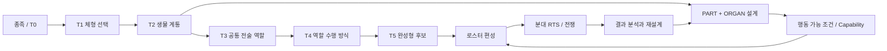

<p align="center"></p>

# CREATURE WAR

### Evolving Creatures × Squad RTS × Strategic Warfare

**생물 설계가 전술을 바꾸는 전략 RTS — 시스템 기획 · 개발 과정 포트폴리오**

`Unreal Engine 5.8 (전환/개발 중)` · `Unity 6 (선행 프로토타입)` · `C++ / C#` · `Data-driven Design` · `Trellis.cpp (3D 생성 실험)`

[게임 전체 개요](./docs/game-overview.md) · [게임 루프](./docs/game-loop.md) · [3계층 지휘](./docs/war-command-structure.md) · [네트워크 구상](./docs/network-architecture.md) · [인터랙티브 트리](./index.html)


> **Portfolio / Work in Progress.** 이 저장소는 채용 검토용 공개 자료입니다. 실제 게임 저장소 전체가 아니며, 공개된 CSV는 설계·관리 데이터 샘플입니다. 기능 및 3D 모델의 완성도는 검증된 범위까지만 기술합니다.

## 30초 소개

CREATURE WAR는 플레이어가 생물의 신체(BODY/HEAD/PART)와 생리(ORGAN)를 설계하고, 그 결과물을 편성해 분대 단위 RTS 전쟁에 투입하는 게임 프로젝트입니다. 핵심 가설은 **생물의 외형적·생리적 선택이 단순 스탯 보정을 넘어 실제로 가능한 행동과 전술적 역할을 달라지게 한다**는 것입니다.

이 포트폴리오는 **트리 데이터의 구조화, 모듈 책임 분리, 단계별 검증과 오류 개선 과정**에 초점을 맞춥니다.



## 게임의 전체 구조: 제작 → 지휘 → 전쟁 → 성장

이 프로젝트는 단순한 '몬스터 생성기'가 아니라 **커스텀 생물 제작이 실제 대규모 협력 전쟁의 전략과 전술에 연결되는 게임**을 목표로 합니다. 설계한 생물을 매치 전에 편성하고, 전쟁 중에는 신규 생물을 즉석 생산하지 않는 방향입니다. **T0부터 참전**할 수 있으며, 고티어 성능과 저티어 COST 효율 사이에 선택을 만듭니다.


전쟁은 **전략 전구 → 전술 전구 → 분대 전구**로 구성됩니다. 전략 지휘관은 목표·보급·예산을, 전술 지휘관은 경로·섹터·분대 파견을, 분대 지휘관은 직접 RTS 명령을 담당합니다. 개체 AI는 공격 수단 선택과 국소 움직임을 실행합니다. 전쟁 내부의 **War COST**와 계정 성장 재화 **Evolution Currency(EC)**를 분리하여, 현장 임무 성과가 다음 생물 설계로 되돌아오는 구조입니다.

- **[프로젝트 전체 개요](./docs/game-overview.md)** — 게임의 목표·차별화·전투·경제·종족·현재 단계
- **[게임 루프 상세](./docs/game-loop.md)** — 매치 전/중/후, 분대 임무, 손실/정찰/보상, 반복 성장
- **[3계층 전구와 지휘관](./docs/war-command-structure.md)** — 전략·전술·분대·유닛 AI 책임 구분
- **[멀티플레이 네트워크 설계](./docs/network-architecture.md)** — P2P/호스트 지향, 연결 흐름, 권한·동기화, 위험·검증 계획

## 네트워크는 어떻게 구성하려는가?

**확정된 방향:** 상시 서버 운영비를 낮추기 위해 *P2P/호스트 기반* 구조를 우선 검토합니다. 전략·전술·분대 지휘 클라이언트들이 하나의 전쟁 상태를 공유해야 하며, **20대20 또는 30대30은 검토했던 목표 규모**이지 달성 성과가 아닙니다.

**후보 구현 방식(아직 확정/실행되지 않음):** 경량 매치 로비/연결 보조 + 권한을 가진 매치 호스트 + 명령 검증과 전구별/관측 영역별 상태 전송. NAT/릴레이, 호스트 이탈, 재접속, AI·물리 동기화, 치트/보상 검증이 필수 테스트입니다. 필요하다면 전용 권한 서버로 전환하는 대안도 비교합니다.

자세한 다이어그램·메시지 흐름과 테스트 로드맵은 **[네트워크 문서](./docs/network-architecture.md)**에 있습니다. **온라인 멀티플레이 구현 완료를 주장하지 않습니다.**

## 데이터 모델과 범위

| 설계 데이터 | 확인 가능한 규모 | 의미 |
|---|---:|---|
| 최상위 체형 | 4개 | 무정형 · 4족형 · 2족형 · 용족형 |
| 종족 | 16개 | 체형당 4개 |
| T0 + T1 + T2 | 272개 노드 | 종족당 1 + 4 + 12 |
| T3 공통 역할 | 9개 | 모든 T2에서 분기 가능한 역할 설계 |
| T4 운용 방식 | 36개 | T3 역할마다 4개 |
| T5 완성형 후보 ID | 592개 | 설계 데이터 식별자 — 제작 완료 수 아님 |

대표 공개 샘플인 **4족형 Q01~Q04의 T0~T2 68개 노드**는 [`data/quadruped_nodes_sample.csv`](./data/quadruped_nodes_sample.csv)와 [브라우저 뷰어](./index.html)에서 확인할 수 있습니다.

## 핵심 시스템 관점

| 영역 | 주요 판단 | 구조상 의도 |
|---|---|---|
| BODY | 체형·중량·사지 계획·소켓 | 역할 수행의 구조적 가능성 제한 |
| HEAD / PART | 감각·공격·작업·이동 수단 | 실제 수행 행동 후보 제공 |
| ORGAN | 에너지 공급·신경·생리·정보 처리 | 행동의 효율과 활성 조건 제공 |
| ROLE | T3·T4 전술 목표와 운용 방식 | 직업 고정이 아닌 구조적 특화 |
| SQUAD RTS | 플레이어 명령 + 개체별 실행 | 분대 통제와 생물 고유 AI 분리 |

세부 계약과 의존성은 [아키텍처 문서](./docs/architecture.md)에 정리했습니다.

## 대표 사례: 이미지 → GLB → 품질 검수

Trellis.cpp 기반 자동 생성 실험에서 4면도 합성 이미지, 시트 분할 결과의 중복 형상, BODY·HEAD 접합 문제, 모델 파일 경로 오류가 발생했습니다. 단일 개체 PNG를 분리하고 실행 스크립트의 모델 폴더 탐색·실패 시 중단 처리를 개선하는 실험을 진행했습니다.

**결과:** 입력 형식과 배치 처리 오류는 분석·수정했지만, 전체 자산에 대한 형상 품질과 실제 엔진 접합은 검증 완료로 보지 않습니다. 상세 내용은 [QA 및 개선 기록](./docs/qa-and-lessons.md)을 참조하세요.

## 자료 탐색

- [포트폴리오 핵심 요약](./docs/one-page-summary.md) — 목표, 게임 루프, 네트워크 방향
- [게임 전체 개요](./docs/game-overview.md) — 게임 목적, 차별화, 경제와 단계
- [게임 루프](./docs/game-loop.md) — 매치 전/중/후 상세 흐름
- [전구·지휘 구조](./docs/war-command-structure.md) — 전략→전술→분대
- [네트워크 설계](./docs/network-architecture.md) — 호스트 중심 아키텍처 후보와 검증 계획
- [아키텍처 / 데이터 경계](./docs/architecture.md) — BODY · PART · ORGAN · ROLE
- [설계 의사결정](./docs/design-decisions.md) — 데이터 중심 트리, RTS 조작 방식
- [QA와 문제 해결](./docs/qa-and-lessons.md) — 오류, 원인, 수정, 미완료 검증
- [현재 상태 및 로드맵](./docs/development-status.md) — 설계/실험/검증 분리
- [공개 데이터 사전](./data/README.md) — CSV와 상태값 정의

## 검증 및 열람

브라우저에서 `index.html`을 열면 추가 설치 없이 **4족형 노드 필터·진화 경로·T3/T4 경로 목록**을 볼 수 있습니다. 이는 **설계 데이터 뷰어**이며 게임 플레이 영상이나 실제 동작 데모가 아닙니다.

```bash
python tools/validate_public_data.py
```

이 저장소에는 소유권이 불분명한 3D 원본, 게임 소스 전체, API 키, 실행 모델 가중치 및 검증되지 않은 GLB가 포함되어 있지 않습니다. 프로젝트는 개발 중이며, 실험 결과와 실제 엔진 실행 결과를 구분해 기록합니다.

**공개 목적:** 프로젝트의 시스템 설계 방식, 개발 진행 관리, 트러블슈팅 과정 소개. 재사용 라이선스는 별도로 부여하지 않습니다.
