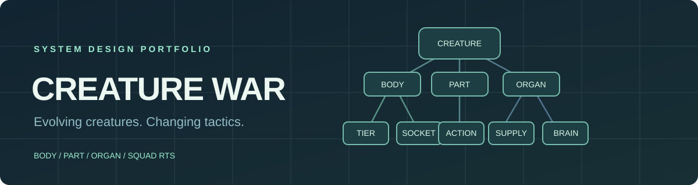
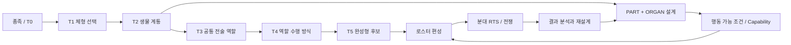

<p align="center"></p>

# CREATURE WAR

### Evolving Creatures × Squad RTS × Strategic Warfare

**생물 설계가 전술을 바꾸는 전략 RTS — 시스템 기획 · 개발 과정 포트폴리오**

`Unreal Engine 5.8 (전환/개발 중)` · `Unity 6 (선행 프로토타입)` · `C++ / C#` · `Data-driven Design` · `Trellis.cpp (3D 생성 실험)`

[트리 데이터 뷰어](./index.html) · [핵심 설계](./docs/architecture.md) · [의사결정](./docs/design-decisions.md) · [문제 해결](./docs/qa-and-lessons.md) · [개발 현황](./docs/development-status.md)


> **Portfolio / Work in Progress.** 이 저장소는 채용 검토용 공개 자료입니다. 실제 게임 저장소 전체가 아니며, 공개된 CSV는 설계·관리 데이터 샘플입니다. 기능 및 3D 모델의 완성도는 검증된 범위까지만 기술합니다.

## 30초 소개

CREATURE WAR는 플레이어가 생물의 신체(BODY/HEAD/PART)와 생리(ORGAN)를 설계하고, 그 결과물을 편성해 분대 단위 RTS 전쟁에 투입하는 게임 프로젝트입니다. 핵심 가설은 **생물의 외형적·생리적 선택이 단순 스탯 보정을 넘어 실제로 가능한 행동과 전술적 역할을 달라지게 한다**는 것입니다.

이 포트폴리오는 **트리 데이터의 구조화, 모듈 책임 분리, 단계별 검증과 오류 개선 과정**에 초점을 맞춥니다.



## 데이터 모델과 범위

| 설계 데이터 | 확인 가능한 규모 | 의미 |
|---|---:|---|
| 최상위 체형 | 4개 | 무정형 · 4족형 · 2족형 · 용족형 |
| 종족 | 16개 | 체형당 4개 |
| T0 + T1 + T2 | 272개 노드 | 종족당 1 + 4 + 12 |
| T3 공통 역할 | 9개 | 모든 T2에서 분기 가능한 역할 설계 |
| T4 운용 방식 | 36개 | T3 역할마다 4개 |
| T5 완성형 후보 ID | 592개 | 설계 데이터 식별자 — 제작 완료 수 아님 |

대표 공개 샘플인 **4족형 Q01~Q04의 T0~T2 68개 노드**는 [`data/quadruped_nodes_sample.csv`](./data/quadruped_nodes_sample.csv)와 [브라우저 뷰어](./index.html)에서 확인할 수 있습니다.

## 핵심 시스템 관점

| 영역 | 주요 판단 | 구조상 의도 |
|---|---|---|
| BODY | 체형·중량·사지 계획·소켓 | 역할 수행의 구조적 가능성 제한 |
| HEAD / PART | 감각·공격·작업·이동 수단 | 실제 수행 행동 후보 제공 |
| ORGAN | 에너지 공급·신경·생리·정보 처리 | 행동의 효율과 활성 조건 제공 |
| ROLE | T3·T4 전술 목표와 운용 방식 | 직업 고정이 아닌 구조적 특화 |
| SQUAD RTS | 플레이어 명령 + 개체별 실행 | 분대 통제와 생물 고유 AI 분리 |

세부 계약과 의존성은 [아키텍처 문서](./docs/architecture.md)에 정리했습니다.

## 대표 사례: 이미지 → GLB → 품질 검수

Trellis.cpp 기반 자동 생성 실험에서 4면도 합성 이미지, 시트 분할 결과의 중복 형상, BODY·HEAD 접합 문제, 모델 파일 경로 오류가 발생했습니다. 단일 개체 PNG를 분리하고 실행 스크립트의 모델 폴더 탐색·실패 시 중단 처리를 개선하는 실험을 진행했습니다.

**결과:** 입력 형식과 배치 처리 오류는 분석·수정했지만, 전체 자산에 대한 형상 품질과 실제 엔진 접합은 검증 완료로 보지 않습니다. 상세 내용은 [QA 및 개선 기록](./docs/qa-and-lessons.md)을 참조하세요.

## 자료 탐색

- [포트폴리오 핵심 요약](./docs/one-page-summary.md) — 목표, 설계, 주요 선택
- [아키텍처 / 데이터 경계](./docs/architecture.md) — BODY · PART · ORGAN · ROLE
- [설계 의사결정](./docs/design-decisions.md) — 데이터 중심 트리, RTS 조작 방식
- [QA와 문제 해결](./docs/qa-and-lessons.md) — 오류, 원인, 수정, 미완료 검증
- [현재 상태 및 로드맵](./docs/development-status.md) — 설계/실험/검증 분리
- [공개 데이터 사전](./data/README.md) — CSV와 상태값 정의

## 검증 및 열람

브라우저에서 `index.html`을 열면 추가 설치 없이 **4족형 노드 필터·진화 경로·T3/T4 경로 목록**을 볼 수 있습니다. 이는 **설계 데이터 뷰어**이며 게임 플레이 영상이나 실제 동작 데모가 아닙니다.

```bash
python tools/validate_public_data.py
```

이 저장소에는 소유권이 불분명한 3D 원본, 게임 소스 전체, API 키, 실행 모델 가중치 및 검증되지 않은 GLB가 포함되어 있지 않습니다. 프로젝트는 개발 중이며, 실험 결과와 실제 엔진 실행 결과를 구분해 기록합니다.

**공개 목적:** 프로젝트의 시스템 설계 방식, 개발 진행 관리, 트러블슈팅 과정 소개. 재사용 라이선스는 별도로 부여하지 않습니다.
