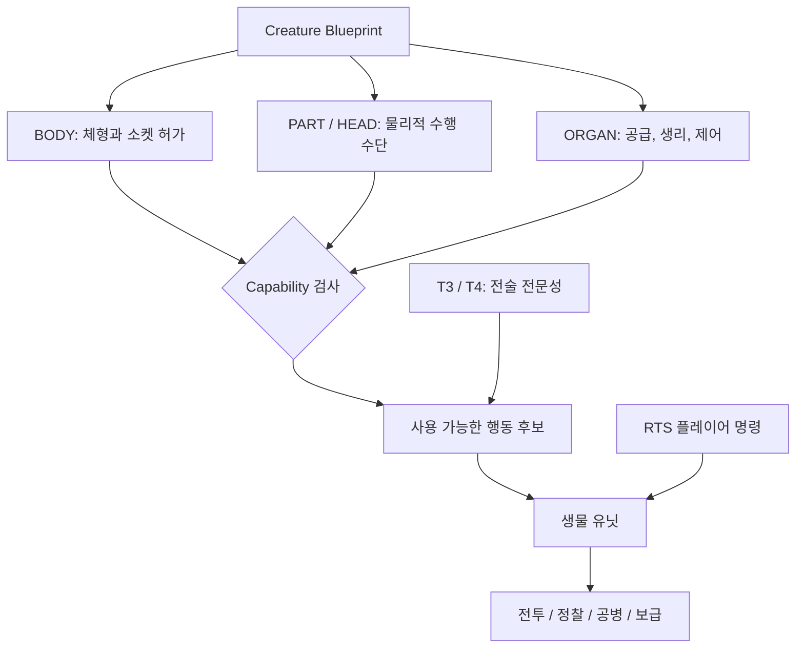
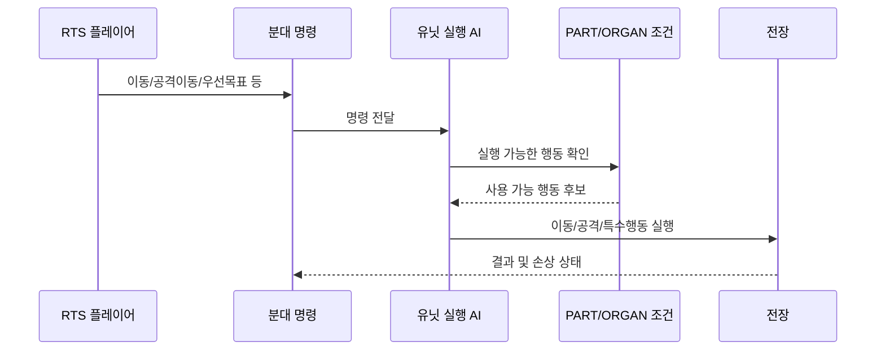

# 시스템 아키텍처와 데이터 경계

## 계층별 책임

- **BODY:** 형태, 크기, 신체 기반, 파츠 부착 가능 영역, 허가 및 제약. BODY 선택 자체가 공격이나 독 능력을 자동으로 부여하지 않습니다.
- **HEAD/PART:** 감각기, 다리, 발톱, 날개, 방호 구조, 작업 파츠처럼 물리적 행동 수단을 담당합니다.
- **ORGAN:** 공급, 대사, 신경, 특수 생리 등의 기능을 담당합니다. 실제 구현 단계에서 수치 및 실행 규칙 연결이 필요합니다.
- **ROLE:** 역할을 클래스처럼 고정하지 않고, T3/T4의 구조적 전문성과 PART/ORGAN Capability의 조합으로 해석합니다.

## 진화 경로

동일 종족이 T3에서 여러 역할로 향할 수 있습니다. T5는 경로에 따른 완성 후보로 해석해야 하며, **592개의 식별자가 592개의 제작 완료 모델을 의미하지는 않습니다.**

## 실행 단계의 경계

> 위 다이어그램은 **목표 아키텍처**입니다. 공개 저장소에 실제 전투 런타임이 포함되어 있지 않으므로 모든 연결이 구현·검증 완료되었다는 뜻은 아닙니다.

## 상위 전쟁 및 네트워크와의 접점

- **전구 데이터의 상향/하향 연결:** 전략 목표·War COST → 전술 임무/분대 예산 → 분대 RTS 명령, 반대로 정찰·손상·임무 결과가 상위 전구로 보고됩니다.
- **전투 상태 권한:** 명령을 전달하는 클라이언트와 전장의 최종 상태 판정 권한을 분리하는 **후보 구조**가 필요합니다. 현재 네트워크 구현 확정/완료 상태가 아닙니다.
- **정찰 권한:** Contact/Tracked/Confirmed Intel은 계층별로 다르게 전달되며, 적의 숨겨진 위치를 모든 클라이언트에 전송하면 안 됩니다.

상세 내용은 [전구·지휘 구조](war-command-structure.md), [게임 루프](game-loop.md), [네트워크 구축 구상](network-architecture.md)을 참조하세요.
