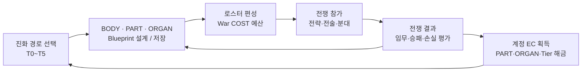
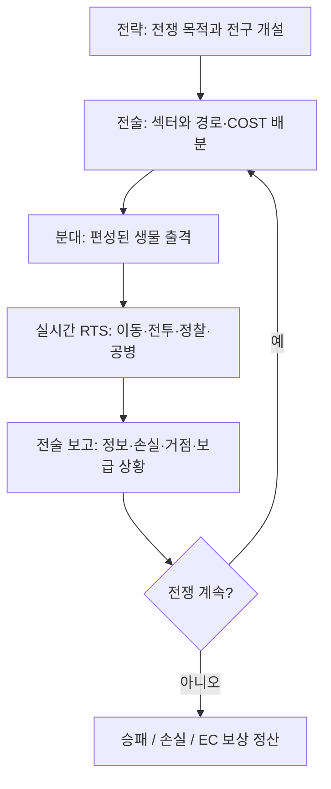

# Creature War | 핵심 게임 루프 및 진행 흐름

> **구분:** 확정된 게임 방향을 플레이어 경험 기준으로 정리한 설계 문서입니다. 작전 UI/보상/멀티플레이 전체 기능이 완성되었다는 의미가 아닙니다.

## 1. 계정 성장의 반복 루프 (Macro Loop)

1. **생물 설계:** T0 종족을 선택하고 체형·생물학적 계통·전술 역할·수행 방식을 거쳐 구조를 확정합니다. PART/ORGAN을 부착하고 실제 동작 조건을 검사합니다.
2. **로스터 등록:** 유효한 Blueprint를 저장해 출전 가능한 생물 목록에 등록합니다. 고티어만 고집할 필요 없이 목적에 맞게 T0~T5를 섞습니다.
3. **매치 준비:** 원하는 지휘 역할과 작전을 결정하고 배정된 War COST 안에서 투입 전력을 편성합니다. **매치 중 새로운 생물을 즉시 제작하는 구조는 아닙니다.**
4. **전쟁 참여:** 전략·전술·분대 지휘관 간 목표/보급/정보를 교환하고, 분대 RTS에서 직접 유닛 명령을 내립니다.
5. **결과 정산:** 생존, 임무 수행, 점령/시설 유지, 정찰 보고 등 결과를 기준으로 보상과 손실을 계산합니다. 단순 킬 수만으로 보상하지 않습니다.
6. **재투자:** 전쟁 보상 EC로 설계 선택지를 열고 다음 전투에서 부족했던 능력을 보완합니다.

## 2. 한 번의 전쟁 안에서 진행되는 루프 (War Loop)

### 서로 연결되는 자원과 목표

- **War COST:** 해당 전쟁 내부의 예산. 전략에서 전술로, 전술에서 분대로 배분됩니다. 출격/유지/회복/시설 등 행동에 영향을 줍니다.
- **점령과 시설:** 장기 보급·중계·수송·정찰시설은 지역 통제와 연결됩니다. 전략시설의 설치에는 Secured 지역 조건이 존재합니다.
- **정보:** 센서로 확보한 일시 관측은 곧바로 모든 지휘관의 확정 정보가 되지 않습니다. 전달/귀환/보고 경로가 정보의 신뢰성과 활용에 영향을 줍니다.
- **분대 생존:** 출격 개체가 살아 돌아오면 배치 원금 회수, 사망하면 회수 불가라는 War COST 규칙을 기획했습니다(세부 수치 검증 대상).
- **정산:** 전쟁 내부 War COST는 영구 성장용 EC와 별도 관리됩니다. 전략/전술/분대별 위험과 임무 성과에 따라 EC 보상이 달라지게 설계했습니다.

## 3. 한 분대의 실제 플레이 예시 (가상 시나리오)

이 예시는 **설계 의도를 보여주는 시나리오**이며 실제 게임 플레이 영상이 아닙니다.

| 단계 | 지휘·플레이 행동 | 결과와 다음 선택 |
|---|---|---|
| 계약 | 전술 지휘관이 적 보급로 정찰 임무 제시 | 분대가 예산 범위의 생물 선택 |
| 편성 | 값싼 정찰 다수 + 감지·은폐 기관 보유 개체 구성 | 화력보다 시야·지속성이 우선 |
| 접근 | 경로 지정·잠복·우선 목표 설정 | 개체 AI는 지역 이동·탐지 실행 |
| 탐색 | Contact 획득, 잔류 센서 설치 시도 | 적이 감지탑으로 역정찰 가능 |
| 철수 | 중요 정보를 가진 생물 귀환 | Confirmed Intel 등록 요건 충족 가능 |
| 정산 | 작전 성과, 손실, 회수 자원 계산 | 정찰 능력 또는 보급을 개선해 재출격 |

## 4. 왜 이 루프를 택했는가

성장과 전술을 분리하지 않기 위해서입니다. 전쟁에서 겪은 문제(사거리 부족, 탐지 불가, 보급 부족, 지형 부적응)가 다음 **구조·기관 선택의 이유**가 되도록 설계합니다. 저티어는 물량/유지비, 고티어는 집중 전투력/고위험 임무에 강점을 두어 한쪽이 모든 상황을 대체하지 않도록 의도했습니다.

## 5. 아직 검증되지 않은 경계

정확한 한 매치의 소요 시간, 최종 승리 조건별 수치, 매치메이킹, 20v20/30v30의 실측 동작, 보상 서버 판정은 현재 **검증 완료 상태가 아닙니다**. 수치는 향후 밸런싱·프로토타입 결과에 따라 조정될 수 있습니다.
