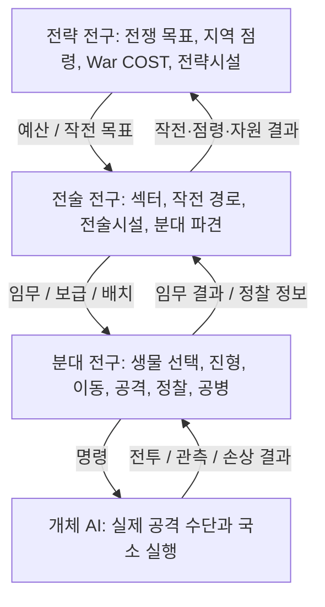

# Creature War | 프로젝트 전체 개요

> **문서 구분:** 기획 목표와 규칙 설계에 대한 공개 요약입니다. 실행 가능한 게임 또는 멀티플레이 서비스의 완성 보고서가 아닙니다. 기준: 2026-11-07.

## 1. 게임 한 문장

**플레이어가 생물을 직접 설계·진화시키고, 그 생물이 할 수 있는 행동과 보급 비용을 바탕으로 분대를 편성하여 여러 지휘 계층이 협력하는 대규모 RTS 전쟁에 참가하는 전략 게임.**

기존 RTS의 생산 유닛이 고정된 병종 목록이라면, Creature War의 유닛은 **BODY(체형), HEAD/PART(외부 기관), ORGAN(내부 생리), Tier와 선택 진화**를 조합한 개별 설계 결과입니다. 공격력 수치뿐 아니라 *기동 방식, 무기 사용 가능 여부, 탐지, 은폐, 건설, 보급 지속성* 등 가능한 행동 자체가 달라지는 것을 목표로 합니다.

## 2. 핵심 경험과 차별화

| 경험 | 플레이어가 결정하는 것 | 게임에서 달라질 것(목표) |
|---|---|---|
| 생물 제작·진화 | 종족(T0) → 체형(T1) → 계통(T2) → 역할(T3) → 방식(T4) → 완성 구조(T5) | 실루엣, 사지/소켓, 장기 수용, 강점과 결함 |
| PART/ORGAN 조합 | 발톱·외피·센서·추진 수단, 뇌/대사/순환/특수 생리 | 행동 후보, 소모, 감지·조작·전투 능력 |
| 로스터·분대 편성 | 기존에 만든 생물을 COST 예산 내에서 선발 | 저비용 다수와 고성능 소수의 선택 |
| RTS 지휘 | 이동·공격이동·진형·잠복·정찰·시설 건설 | 지휘관의 전략과 생물 구조가 맞물린 전투 |
| 다계층 협력 전쟁 | 전략 목표/자원 배분 → 전술 작전/파견 → 분대 현장 수행 | 역할 간 임무와 보급의 상호 의존 |
| 결과 분석과 성장 | 손실·임무 성과·정찰 정보·보상을 평가 | 다음 진화/설계와 전쟁의 선택지 확장 |

**역할은 고정 직업이 아닙니다.** 예를 들어 정찰·공병, 전투·보급 등 복합 수행은 허용하되 실제 수행 여부와 효율은 PART/ORGAN과 구조 조건으로 결정하게 설계합니다.

## 3. 전쟁 이전, 전쟁 중, 전쟁 이후

- **전쟁 이전 / 제작·편성:** 생물 설계와 진화를 마치고 로스터에 저장. T5가 없어도 T0부터 참전 가능. 출격 전 COST 예산 내에서 분대를 편성합니다.
- **전쟁 중 / 협력 지휘:** 전략 지휘관이 전구와 전쟁 경제를, 전술 지휘관이 작전·분대 파견을, 분대 지휘관이 실제 RTS 유닛을 통제합니다. 개체 AI는 공격수단 선택·국소 이동을 보조하지만 플레이어의 상위 명령을 대체하지 않습니다.
- **전쟁 이후 / 결과 정산:** 승패·점령·목표 수행·자원·손실과 임무 성과를 정산합니다. 전쟁 내부의 **War COST**와 계정 성장 재화 **Evolution Currency(EC)**는 구분합니다. EC로 새로운 PART·ORGAN·진화 선택지를 해금하는 장기 성장 루프를 계획합니다.

## 4. 전쟁 전구와 플레이어 역할

- **전략 지휘관:** 전쟁의 장기 목표, 전략시설과 보급, 자원/전력의 배분, 전술 전구의 개설과 우선순위를 결정합니다.
- **전술 지휘관:** 전술 지역, 경로, 섹터, 분대 파견과 임무 계약, 공병과 시설, 전술 보급을 관리하며 자기 지휘분대를 직접 운용할 수 있습니다.
- **분대 지휘관:** 배정된 War COST 안에서 T0~T5 혼합 편성을 하고 선택·이동·공격이동·정찰·은폐·건설 등 RTS 명령을 내립니다.

## 5. RTS 전투 및 정보전

- PART가 실제 공격/이동/작업 수단을 제공하고 ORGAN이 공급·통제 가능 여부에 관여합니다.
- 파츠 손상으로 기존 행동 후보를 잃거나 기능 효율이 떨어지는 구조를 목표로 합니다.
- 정찰은 단순 시야 공유가 아니라 **Contact → Tracked Contact → Confirmed Intel**의 정보 품질 단계로 설계되었습니다. 정찰 개체가 귀환·보고하여 상위 정보가 확정되는 구조입니다.
- 확보한 지역(Secured)과 감시망까지 제거된 지역(Sanitized)을 구분하며, 감지탑·잔류 정찰체·시설이 전술 목표를 바꿀 수 있습니다.

## 6. 진행 단계와 공개 범위

| 구분 | 현재 공개 가능한 상태 |
|---|---|
| 4대 체형 · 16종족 | 설계 정의 |
| T0~T2 총 272개 노드 | 데이터 정의 (공개 샘플 4족형 68개) |
| T3 역할 9개 · T4 방식 36개 | 설계 정의 |
| 역할/명령/Capability/War COST 규칙 | 설계와 선행 프로토타입 규칙 존재; 전체 엔진 통합 검증 미완료 |
| Unreal Engine 5.8 이전 및 3D 모델 제작 | 개발·실험 진행 중 |
| 대규모 멀티플레이 네트워크 | **아키텍처 방향 논의·기술 검증 전** |

자세한 플레이 순서는 [게임 루프](game-loop.md), 지휘 계층은 [전구·지휘 구조](war-command-structure.md), 연결 구조는 [네트워크 아키텍처](network-architecture.md)를 참조하세요.
