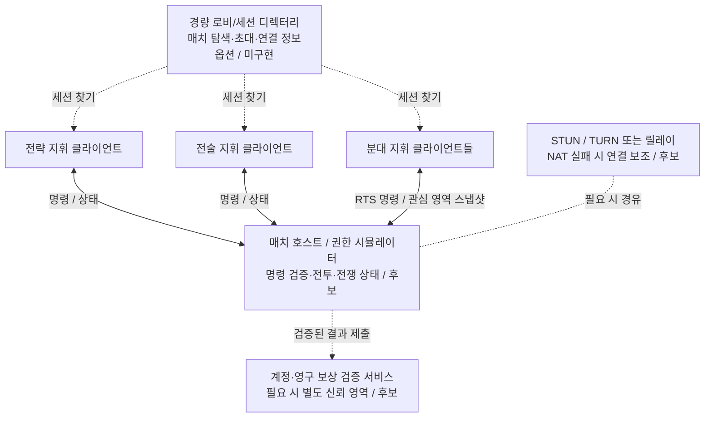
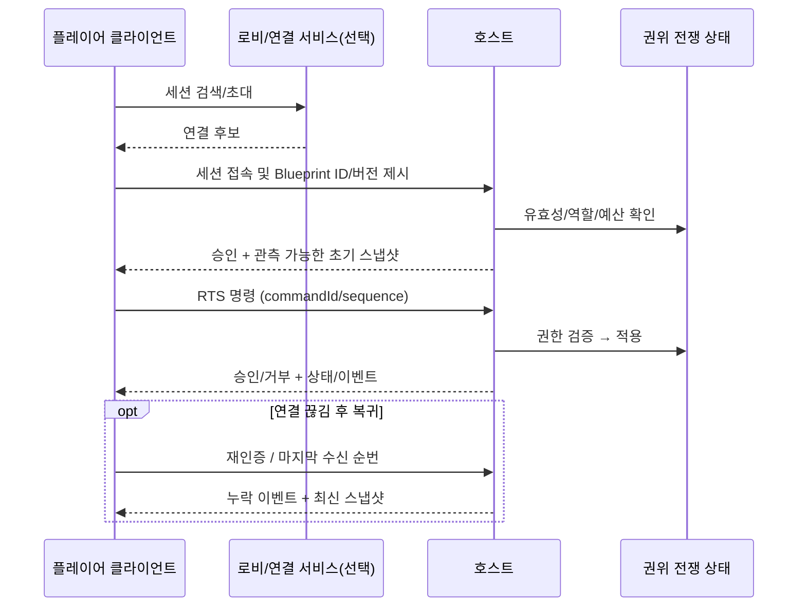

# Creature War | 멀티플레이 네트워크 구축 구상

> **상태: 기획 및 기술 검증 계획 / 실제 온라인 멀티플레이 구축·부하 테스트 완료 아님.**
>
> 기존 기획에서 확인되는 방향은 **상시 서버 운영비 최소화를 위한 P2P/호스트 기반**입니다. 20 vs 20 / 30 vs 30은 *목표 검토 규모*일 뿐 성능을 달성한 기록은 아닙니다. 아래 상세 메시지·보안·전송 체계는 그 방향을 구현하기 위한 **후보 설계 제안**으로서 확정 사양이 아닙니다.

## 1. 목표와 제약

- 여러 플레이어가 **전략·전술·분대 역할**로 나뉘어 같은 전쟁에 참여.
- 개체별 이동/공격은 AI가 실행하지만 플레이어 RTS 명령은 통제권을 유지.
- 보급, 건설, 점령, 탐지, PART 손상 등 서로 영향을 주는 **공통 전장 상태**가 일관되어야 함.
- 모든 개체의 모든 프레임을 모든 참가자에게 보내지 않도록 네트워크 부하 절감.
- 로비 검색·접속·NAT·호스트 이탈·재접속·치트 방지·보상 위조가 핵심 위험.

## 2. 원안과 후보 연결 구조

### 원안(기획에서 확인됨)

**호스트/P2P 방식 선호**, 상시 전용 서버 비용을 줄이는 방향. 전송 방식, 권한, 보안 정책과 실제 동접 목표는 검증 전입니다.

### 상세 후보: 호스트 권한형 매치 + 접속 보조 서비스

이 구조는 **모든 참가자가 모든 참가자에게 직접 메시지를 보내는 완전 메시형 P2P**와 다릅니다. 플레이어 호스트를 단일 매치 권위로 두면 명령 수집·검증 및 결과 순서를 통일하기 쉬우며, 로비/중계 같은 부가 서비스만 별도 운영할 수 있습니다. 그러나 호스트 치트, 성능·업로드 대역폭, NAT, 호스트 이탈이 실제 대규모 전쟁에서 문제가 될 수 있습니다.

**대안:** 큰 규모에서 호스트 방식이 성능·공정성 조건을 만족하지 못하면, *동일한 명령/상태 계약*을 유지한 채 **전용 권한 서버(서버 authoritative)**로 전환하는 선택지를 검토합니다. 현재 해당 서버를 구현했다고 주장하지 않습니다.

## 3. 플레이어가 매치에 들어오는 절차 (후보 프로토콜)

1. **매치 탐색/초대:** 참가자가 세션 정보를 받고 전략·전술·분대 역할을 선택합니다. 로비 서비스의 구체적 제품/플랫폼은 미확정.
2. **연결 수립:** 직접 호스트 연결 시도 → 실패하면 릴레이 경유 검토. NAT/방화벽 환경별 실제 접속률 측정 필요.
3. **입장 검증:** 계정 권한과 선택된 Blueprint/로스터의 식별자·버전·COST 유효성 확인. 클라이언트가 임의로 보낸 공격력·자원은 곧바로 신뢰하지 않습니다.
4. **초기 상태:** 참가자에게 자기 역할에 필요한 전구·부대 정보와 관측 가능 상태를 전달합니다.
5. **명령 전송:** `playerId`, `unit/squadId`, `commandId`, `clientTick`, `orderType`, `target`, `catalogVersion` 등의 **예시 필드**를 호스트에 제출. 호스트는 소유권/계약/예산/행동 가능 여부와 중복 명령을 검사합니다.
6. **권한 시뮬레이션:** 호스트가 명령의 순서와 전쟁 상태를 적용하고, 결과 스냅샷/이벤트를 각 참여자의 관측 권한에 맞게 전송합니다.
7. **결과 정산:** 종료 시 승패·COST·임무 결과를 집계합니다. **영구 EC는 클라이언트나 비신뢰 호스트의 단독 신고로 확정하면 안 됩니다.** 신뢰 가능한 별도 검증/승인 수단이 필요합니다.

## 4. 동기화 원칙: 명령과 결과를 구분

| 영역 | 후보 동기화 데이터 | 의도된 빈도 / 우선순위 | 위험 |
|---|---|---|---|
| 전략 전구 | 섹터 소유, War COST, 시설, 전구 상태 | 이벤트 중심, 변동 시 | 영구 자원/점령 불일치 |
| 전술 전구 | 분대 파견, 전술 경로, 정보·보급, 시설 상태 | 명령/이벤트 중심 | 상·하위 전구 상태 지연 |
| 분대 RTS | 플레이어 명령, 단위 위치/상태, PART 손상, 공격 결과 | 관심 영역 중심 상태 스냅샷 + 핵심 이벤트 (수치는 실측 후) | 유닛 수 급증 시 대역폭·CPU 부담 |
| 정찰/정보전 | 관측자/진영별 Contact, 위치와 신뢰도 | **권한이 허용된 정보만** | 적 은폐 위치 누출, 안개 전쟁 무력화 |
| 정산 | 승패, 임무 결과, 비용/EC 승인 | 세션 종료/확정 시 | 중복 지급·위조 |

**중요:** 단순 결정론 lockstep을 무조건 가정하지 않습니다. 개체 AI·물리·경로 탐색·PART 파괴 규칙에 플랫폼별 비결정성이 존재할 수 있기 때문입니다. *명령만 전송하는 방식*과 *상태 스냅샷 기반 방식*을 비교 시험해야 하며, 어떤 tick rate/압축법/프로토콜을 사용할지 아직 확정되지 않았습니다.

## 5. 수명주기와 실패 대응 (후보 설계)

- **중복/재전송:** 명령에 고유 ID와 순번을 부여하고 적용을 한 번으로 제한하는 방식을 검토합니다.
- **호스트 이탈:** 호스트 마이그레이션의 권위 상태 이관·동시성·치트 위험을 검증해야 합니다. 성공 보장을 주장하지 않으며, 초기에 세션 중단/무효 처리도 후보입니다.
- **재접속:** 세션 상태 보존 기간, 최신 스냅샷 재동기화, 유닛/명령 소유권 복원이 필요합니다.
- **안개·정보 보안:** 서버/호스트가 전장 전체를 보유하더라도 클라이언트에는 관측권한에 맞는 데이터만 전달해야 합니다.
- **성능:** 공간 분할, 관심 영역(interest management), 명령 결합·비신뢰 위치 보정·이벤트 분리 등을 시험할 수 있으나 **수치·기술 선택은 아직 미확정**입니다.

## 6. 단계별 검증 로드맵

| 단계 | 확인할 것 | 통과 기준 예시 (미확정, 검증 계획) |
|---|---|---|
| N0 로컬 2클라이언트 | 로비·연결·역할·명령 순번·재접속 | 같은 명령을 중복 적용하지 않고 상태가 일치 |
| N1 소규모 대전 | 분대 이동/공격/정찰/War COST 권한 | 실제로 수행한 명령·결과가 동일하게 정산 |
| N2 실전 네트워크 | NAT/릴레이, 지연·손실·호스트 이탈 | 재접속 및 동기화 실패 양상을 기록 |
| N3 다인 지휘 | 전략/전술/분대 지휘 분담, 정보전 누출 검사 | 다른 전구의 잘못된 명령·정보가 차단 |
| N4 부하 확장 | 인원/개체 수 증가, CPU·메모리·대역폭 | 목표에 맞는 처리량 확보 여부 측정 |
| N5 목표 규모 검증 | **20v20 / 30v30** (목표 검토 규모) | 실측 자료로 가능/불가능 및 대안을 결정 |

> **포트폴리오 기재 기준:** 네트워크 *설계 목표/권한 모델 검토/위험 분석*으로 소개합니다. 미확정 서버 프로그램, 로비 서비스, 20v20/30v30 실시간 성능을 **구현 완료**라고 적지 않습니다.
