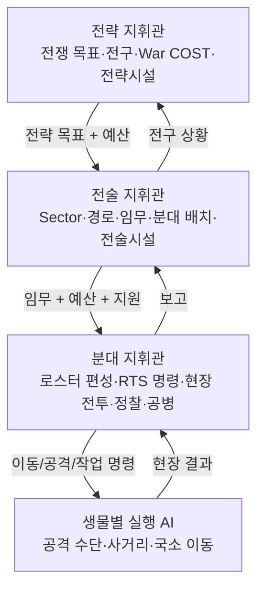

# Creature War | 전략·전술·분대 지휘 구조

> 지휘 3계층은 게임 설계의 핵심입니다. 아래 명령 흐름과 권한은 **목표 게임 규칙**이며 네트워크 구현 완료를 의미하지 않습니다.

## 1. 왜 3계층인가?

전략 지도 한 화면에서 모든 유닛의 공격을 직접 명령하는 방식은 대규모 전쟁에서 지휘 부담이 과도합니다. 반대로 전부 AI에 맡기면 RTS 지휘 경험이 사라집니다. 따라서 **전략 지휘관 → 전술 지휘관 → 분대 지휘관 → 개체 행동 AI**로 책임을 분리합니다.

## 2. 책임과 플레이 화면

| 계층 | 주요 화면·대상 | 권한과 역할 | 주된 제약 |
|---|---|---|---|
| 전략 | 전쟁 전체·전술 전구·전략시설·광역 보급 | 대전략 목표, 지역/전구 투자, War COST와 보급·수송 관리 | 자원, 시설/통신망, 지역 통제 |
| 전술 | 전술 지도·섹터·전술시설·파견 분대 | 진입 경로, 임무, 분대 계약, 건설/지원 명령, 자기 지휘분대 개입 | 배정 COST, 경로/위험/정보 |
| 분대 | RTS 전장·개체/그룹 선택 | 편성, 이동·공격이동·표적 우선순위·잠복·정찰·시설 설치 | 예산, PART/ORGAN 행동 가능 조건 |
| 개체 AI | 생물 로컬 행동 | 가용 공격수단 선택, 회피, 사거리 유지, 공격 타이밍 | 플레이어 상위 명령과 개체 능력 |

> **참고:** 개체 수 제한을 고정하지 않고 COST가 편성 규모를 제한하는 설계입니다. 제한이 없다는 표현은 실제 처리 가능한 개체 수가 무제한이라는 뜻이 아닙니다.

## 3. 예산·정보·보상 흐름

- **하향:** 전략 전구 예산/보급 → 전술 전구 배정 → 분대 출격/시설/유지 비용.
- **상향:** 분대의 손실, 정찰, 시설, 임무 결과 → 전술 지휘관의 전구 상태 → 전략 지휘관의 전체 판단.
- **지속 정찰:** Contact → Tracked Contact → 귀환/보고에 의한 Confirmed Intel. 지역 확보(Secured)와 숨겨진 감시체 제거(Sanitized)는 구분합니다.
- **전쟁 종료:** 역할에 따라 EC 정산 성격이 다릅니다. 전략 지휘관의 하이리스크·하이리턴과 분대의 목표 수행 보상을 구분합니다. 공개 수치만으로 구현 완료를 주장하지 않습니다.

## 4. 일반 RTS 명령과 행동 AI의 분리

분대 플레이어의 명령이 우선입니다. 실제 실행 AI는 목표 선정 시 명시된 우선 대상에 따르고, 현재 PART/ORGAN·보급·파손 상태에서 실행할 수 있는 공격 후보를 고릅니다. 설계된 기능을 실제 3D 전장 이동/전투와 끝까지 연결하는 작업은 검증 중입니다.
